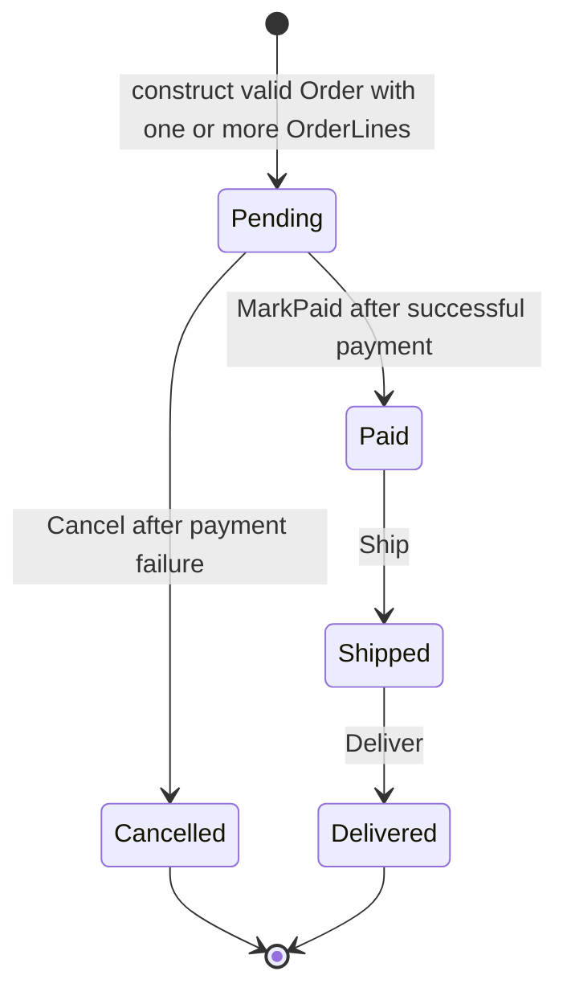

# Order aggregate lifecycle

This diagram describes the current in-memory domain model. `OrderService` selects a discount policy and coordinates payment; the `Order` aggregate applies the policy, protects the resulting total, and owns lifecycle state changes. Payment failure calls `Cancel()` before the application reports failure. There is no user-initiated cancellation flow yet.

## Aggregate invariants represented in code

- An order has a positive ID, nonblank customer email, nonblank payment method, and at least one non-null line.
- Every `OrderLine` has a product name, positive unit price, and positive quantity.
- The subtotal is derived from line totals; callers receive a read-only line collection.
- A discount can be applied once while the order is pending, and the resulting total must be positive and no greater than the subtotal.
- Only a pending order can become paid. Only a paid order can ship, and only a shipped order can be delivered.
- Only pending orders can currently be cancelled. Cancelling after payment succeeds would require a payment compensation that this pass does not implement.

## Scope notes

- `Pending` is the initial state, before payment has succeeded.
- A declined payment changes the order to `Cancelled`; the in-memory repository still saves only successfully paid orders.
- User cancellation, cancellation reasons, inventory reservation, and payment refunds are future concerns and are not modeled here.
