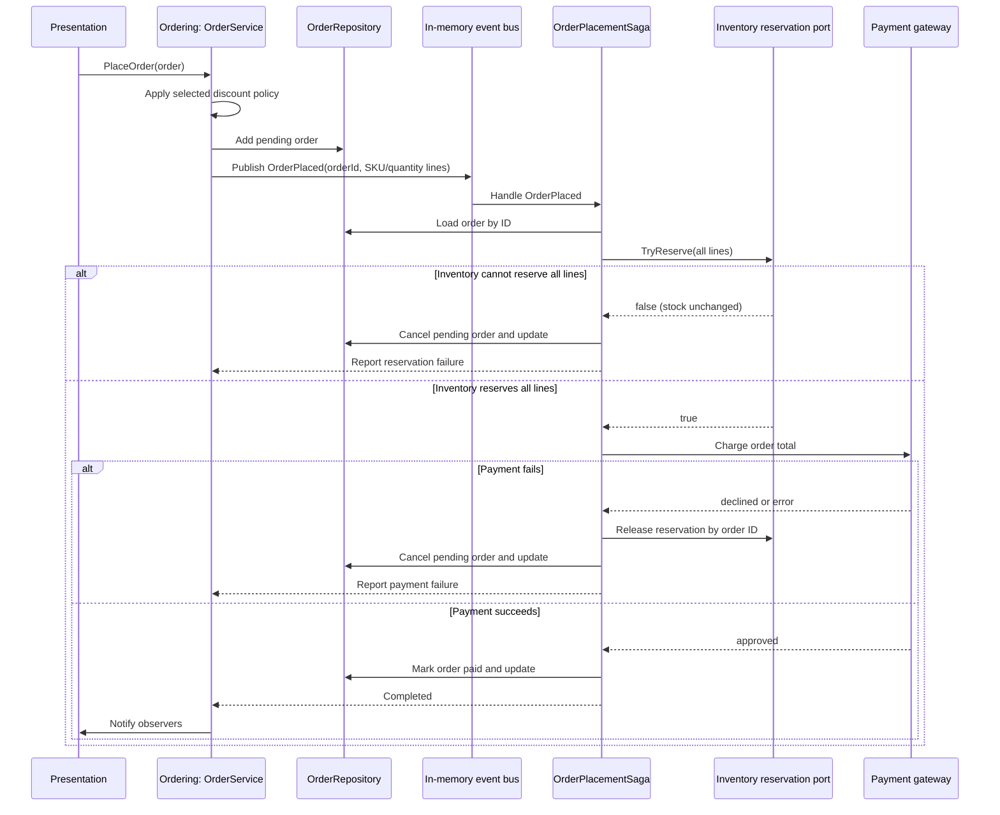

# Phase 2 — Ordering and Inventory contexts

This is the current OrderFlow design after Pass 4. Ordering and Inventory have distinct models, but they still run in one process and are not independently deployed services.

## Context map

| Context | Current code boundary | Owns | Terms and rules |
|---|---|---|---|
| Ordering | `OrderFlow.Domain` | Orders and purchase line snapshots | `Order`, `OrderLine`, SKU reference, purchase unit price, ordered quantity, and order lifecycle. An order's own construction and lifecycle invariants remain local to this context. |
| Inventory | `OrderFlow.Inventory` | Stock available by SKU | `InventoryStock` and the rules that quantity cannot be reserved below zero or released beyond the reserved amount. |

The broader e-commerce sketch treats these as plausible additional contexts, not modules already implemented in OrderFlow:

| Candidate context | Likely ownership | Boundary reasoning |
|---|---|---|
| Catalog | Product descriptions, images, attributes, and current listed price | Describes what can be browsed and sold; it does not own stock reservations. |
| Payments | Payment transactions, authorization, capture, refunds, and their status | Has its own transaction lifecycle and provider-facing rules. The current payment strategies/gateway are an integration seam, not a complete Payments bounded context. |
| Shipping | Shipments, parcels, package dimensions/weight, tracking, and shipment lifecycle | Owns fulfillment operations. Ordering may retain the delivery-address snapshot supplied at checkout. |

These are contexts because they can have distinct language, rules, lifecycle, and authoritative data—not simply because each has a different entity. A bounded context can remain a module inside the monolith; it does not imply a separate service.

`OrderLine` keeps SKU, product name, unit price, and ordered quantity because Ordering needs a record of what was bought and at what price. Inventory does not use that object. Catalog owns the current listed price, while Ordering keeps the price snapshot agreed at purchase. The `OrderPlaced` integration message contains only `OrderId` and `(SKU, quantity)` lines. This avoids sharing either context's domain entities across the boundary.

The Application project owns the event and port contracts because it coordinates the use case. Infrastructure implements the in-memory event bus and the Inventory reservation port. The Presentation composition root wires both contexts together.

## Orchestration flow



## Compensation and consistency

- Inventory reservation is all-or-nothing in this in-memory implementation: it checks every requested SKU before reducing any available quantity. A reservation failure therefore has no Inventory mutation to undo. The Saga compensates for the earlier `Add(pending order)` step by cancelling the order.
- If payment fails after reservation, the Saga releases the reservation recorded for that order, then cancels the order. Release uses the reservation record, so it restores exactly the quantities actually held and a repeated release is harmless.
- On success, the reservation remains held and available stock remains reduced. This exercise does not yet model shipping, reservation expiry, or a later inventory commit.
- The event bus invokes handlers synchronously in memory. It is not durable and does not provide delivery across process restarts. The payment retry window and reservation expiry remain in [the backlog](../BACKLOG.md).
- The Saga avoids repeating work for an already completed order in this process. It does not claim production-grade idempotency for concurrent delivery, process crashes, or an ambiguous payment-provider response.

## Current project references

```text
Presentation → Application, Domain, Infrastructure, Inventory
Infrastructure → Application, Domain, Inventory
Application → Domain
Domain (Ordering) → no outer project
Inventory → no outer project
Tests → Application, Domain, Infrastructure, Inventory (test-time only)
```

The Inventory project is a bounded-context module in a modular monolith. Splitting it into a separately deployed service would add network failure, durable messaging, operational ownership, and data consistency concerns; this exercise has not demonstrated a need for those costs.
